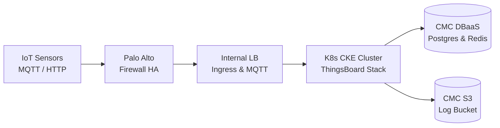

# Báo Cáo & Thuyết Trình Kỹ Thuật: Hệ Thống Cảnh Báo Ngập TP.HCM Trên Nền Tảng CMC Cloud

> **Dự án**: HCM Flood Warning IoT System  
> **Nền tảng**: ThingsBoard CE 3.4.0 Microservices trên CMC Cloud Kubernetes (CKE)  
> **Ngày lập**: 2026-10-15  
> **Tài liệu tham chiếu**: [SYSTEM_FLOW.md](file:///c:/Users/Admin/Downloads/iot/iot-thingsboard/docs/SYSTEM_FLOW.md), [SYSTEM_TRAFFIC_ARCHITECTURE.md](file:///c:/Users/Admin/Downloads/iot/iot-thingsboard/docs/SYSTEM_TRAFFIC_ARCHITECTURE.md)

---

## 📌 Tổng Quan Cấu Trúc Bài Thuyết Trình

| Phần | Nội dung chính | Thời lượng ước tính |
|---|---|---|
| **Phần 1** | Bối cảnh, Đặt vấn đề & Mục tiêu giải pháp | 2 - 3 phút |
| **Phần 2** | Kiến trúc Mạng & An ninh Biên trên CMC Cloud | 4 - 5 phút |
| **Phần 3** | Cụm Kubernetes CKE & Khối Vi Dịch Vụ ThingsBoard | 5 - 6 phút |
| **Phần 4** | Chiến lược Quản trị Dữ liệu & Lưu trữ (DBaaS, PV, S3) | 3 - 4 phút |
| **Phần 5** | Bảo mật Đa Tầng: NetworkPolicy & Kyverno Governance | 3 - 4 phút |
| **Phần 6** | Quy trình DevOps / GitOps & Khả năng Quan sát (Observability) | 3 - 4 phút |
| **Phần 7** | Tổng kết, Hiệu quả Dự án & Hướng Phát triển | 2 - 3 phút |
| **Q & A**  | Hỏi đáp kỹ thuật với Hội đồng / Ban Giám Khảo | 5 - 10 phút |

---

## Slide-by-Slide: Chi Tiết Từng Slide & Gợi Ý Lời Thoại (Speaker Notes)

---

### PHẦN 1: BỐI CẢNH & BÀI TOÁN THỰC TIỄN

#### Slide 1: Trang tiêu đề
* **Tiêu đề**: Kiến Trúc & Triển Khai Hệ Thống IoT Cảnh Báo Ngập Lụt TP.HCM Trên Nền Tảng CMC Cloud Kubernetes
* **Thông tin**: Nhóm phát triển / Kỹ sư phụ trách hạ tầng.
* **Speaker Notes**:
  > *"Kính thưa Hội đồng / Ban Giám khảo, hôm nay tôi xin đại diện nhóm trình bày giải pháp kiến trúc và triển khai hệ thống IoT phục vụ cảnh báo ngập úng đô thị TP.HCM. Hệ thống được thiết kế theo chuẩn microservices container hóa hiện đại, vận hành hoàn toàn trên hạ tầng điện toán đám mây nội địa CMC Cloud."*

#### Slide 2: Bài toán thực tiễn & Thách thức kỹ thuật
* **Nội dung hiển thị**:
  1. **Tính chất dữ liệu**: Hàng trăm trạm đo mực nước, triều cường và lượng mưa tại các điểm trũng gửi dữ liệu liên tục 24/7.
  2. **Yêu cầu High Availability (HA)**: Không được mất kết nối, đặc biệt trong các khung giờ cao điểm mưa bão và triều dâng.
  3. **Yêu cầu bảo mật & chủ quyền dữ liệu**: Dữ liệu công cộng đô thị phải tuân thủ nghiêm ngặt quy định an toàn thông tin, lưu trữ trên hạ tầng cloud trong nước.
* **Speaker Notes**:
  > *"Thách thức lớn nhất của bài toán là phải đảm bảo việc thu thập dữ liệu diễn ra liên tục theo thời gian thực (near real-time) với độ trễ thấp, đồng thời hạ tầng phải có khả năng tự phục hồi, chống chịu sự cố và bảo vệ an toàn trước các nguy cơ tấn công mạng."*

---

### PHẦN 2: THIẾT KẾ MẠNG & AN NINH BIÊN TRÊN CMC CLOUD

#### Slide 3: Phân vùng mạng VPC (Defense-in-Depth)
* **Nội dung hiển thị**:
  * **VPC**: `vpc-lab (10.0.0.0/16)` tại CMC Cloud Region TP.HCM.
  * **Mô hình 3 Subnet độc lập**:
    * `subnet-public / Untrust (10.0.1.0/24)`: Vùng biên tiếp nhận lưu lượng từ Internet/cảm biến.
    * `subnet-private / Trust (10.0.2.0/24)`: Vùng an toàn chứa toàn bộ cụm Kubernetes Worker Nodes & Load Balancer nội bộ.
    * `subnet-db / DBaaS (10.0.3.0/24)`: Phân vùng biệt lập dành riêng cho các hệ quản trị cơ sở dữ liệu.
* **Speaker Notes**:
  > *"Để ngăn chặn nguy cơ xâm nhập, chúng tôi không để ứng dụng lộ diện trực tiếp ra Internet mà phân chia VPC thành 3 phân vùng mạng tách biệt theo mô hình phòng thủ chiều sâu. Mọi luồng thông tin đều được kiểm soát nghiêm ngặt qua từng cửa ngõ."*

#### Slide 4: Bảo vệ cửa ngõ với Palo Alto Firewall HA & Internal Load Balancer
* **Nội dung hiển thị**:
  * **Palo Alto Firewall HA**: Cặp đôi Active/Passive kiểm soát Layer 7, tích hợp IPS/IDS, Anti-DDoS, SSL Inspection và URL Filtering.
  * **Tách biệt 2 luồng cân bằng tải nội bộ (Internal Load Balancer - ILB)**:
    * **ILB Ingress (`10.0.2.192`)**: Tiếp nhận traffic HTTP/HTTPS, Web UI Dashboard và kết nối WebSocket thời gian thực.
    * **ILB MQTT (`10.0.2.193`)**: Kênh độc lập chuyên dụng tiếp nhận dữ liệu telemetry qua giao thức MQTT (Port 1883).
* **Speaker Notes**:
  > *"Việc tách rời ILB Ingress cho Web và ILB MQTT cho cảm biến giúp tách biệt hoàn toàn tải người dùng xem bản đồ ngập với tải gửi dữ liệu từ cảm biến. Dù lượng người dân truy cập tra cứu tăng đột biến khi có ngập, đường truyền dữ liệu của cảm biến vẫn luôn thông suốt."*

---

### PHẦN 3: CỤM KUBERNETES CKE & MICROSERVICES THINGSBOARD

#### Slide 5: Quy hoạch cụm CMC Kubernetes Engine (CKE)
* **Nội dung hiển thị**:
  * **System NodeGroup (2 Nodes - 4 vCPU / 8GB RAM)**: Dành riêng cho các dịch vụ nền tảng hệ thống:
    * NGINX Ingress Controller
    * ArgoCD / Devtron (GitOps Engine)
    * Kyverno (Admission Policy Engine)
    * Observability Stack (Loki, Promtail, Grafana)
  * **Workload NodeGroup (2 Nodes - 4 vCPU / 8GB RAM)**: Dành riêng cho ứng dụng ThingsBoard:
    * `tb-node` (Core & Rule Engine)
    * `tb-mqtt-transport`, `tb-http-transport`, `tb-coap-transport`
    * `tb-web-ui`
    * `tb-js-executor` (tự động co giãn qua HPA từ 2 đến 6 pods)
    * Hàng đợi Apache Kafka & ZooKeeper
* **Speaker Notes**:
  > *"Hạ tầng K8s được phân bổ làm 2 nhóm Node riêng biệt qua cơ chế NodeSelector và Taints/Tolerations. Nhờ đó, các tác vụ quản trị và giám sát hệ thống không bao giờ tranh chấp tài nguyên với các ứng dụng xử lý dữ liệu lõi."*

#### Slide 6: Kiến trúc đệm dữ liệu Kafka & Cơ chế gắn Persistent Volume (PV)
* **Nội dung hiển thị**:
  * **Vai trò của Kafka**: Đệm dữ liệu tốc độ cao (In-flight Buffer), giải tỏa áp lực khi các trạm đồng loạt gửi telemetry.
  * **Lưu trữ bền vững**:
    * Tích hợp StorageClass **`highio`** qua OpenStack Cinder CSI của CMC Cloud.
    * Kafka được gắn PV **10Gi** và ZooKeeper gắn PV **5Gi** theo cơ chế `volumeClaimTemplates` (ReadWriteOnce).
    * Đảm bảo tính toàn vẹn dữ liệu hàng đợi ngay cả khi Pod bị restart hoặc chuyển dời node.
* **Speaker Notes**:
  > *"Ban đầu hệ thống chạy Kafka dạng in-memory tạm thời, nhưng để đáp ứng chuẩn Zero-Message-Loss trong môi trường sản xuất, chúng tôi đã cấu hình StatefulSet tự động cấp phát PV trực tiếp từ dịch vụ Block Storage highio của CMC Cloud."*

---

### PHẦN 4: CHIẾN LƯỢC QUẢN TRỊ DỮ LIỆU & LƯU TRỮ

#### Slide 7: Triết lý "Ephemeral Compute, Eternal Data" & CMC DBaaS
* **Nội dung hiển thị**:
  * **Tách biệt Compute & Storage**: Cụm K8s giữ trạng thái stateless tối đa để dễ dàng xóa/dựng lại tự động khi nâng cấp.
  * **Dịch vụ CMC Managed DBaaS**:
    * **PostgreSQL (DBaaS)**: Lưu cấu hình thực thể thiết bị, chuỗi thời gian telemetry mực nước, lịch sử cảnh báo. Tích hợp sẵn cơ chế auto-backup snapshot hàng ngày.
    * **Redis (DBaaS)**: Bộ nhớ đệm tốc độ cao lưu phiên người dùng và trạng thái online/offline của cảm biến.
  * **CMC S3 Object Storage**: Bucket `hcm-flood-logs` lưu trữ lâu dài (30 ngày) logs của hệ thống từ Loki, tối ưu chi phí hơn 70% so với lưu trên Block Storage.
* **Speaker Notes**:
  > *"Thay vì tự cài đặt và vận hành Database bên trong Kubernetes — vốn tiềm ẩn rủi ro hỏng đĩa và tốn RAM, chúng tôi ủy thác việc này cho CMC DBaaS. Điều này giúp giảm thiểu rủi ro vận hành và đảm bảo an toàn tuyệt đối cho dữ liệu lịch sử ngập."*

---

### PHẦN 5: BẢO MẬT ĐA TẦNG VÀ QUẢN TRỊ NỘI BỘ

#### Slide 8: Network Policy (Zero-Trust trong cụm) & Kyverno Governance
* **Nội dung hiển thị**:
  * **NetworkPolicy (Mô hình Default Deny)**:
    * Khóa toàn bộ giao tiếp tự do giữa các Pod.
    * Chỉ cho phép mở whitelist tường minh: Ingress ➔ Web UI/Node; Transports ➔ Kafka; Node ➔ DBaaS Subnet.
    * Ngăn chặn hoàn toàn rủi ro lây nhiễm ngang (Lateral Movement) nếu một pod bị tấn công.
  * **Chính sách Kyverno**:
    * Chặn các container chạy dưới quyền `root`.
    * Bắt buộc khai báo giới hạn tài nguyên CPU/RAM (Requests & Limits).
    * Xác thực hình ảnh container từ Registry bảo mật.
  * **Truy cập Quản trị**: Bắt buộc xác thực qua VPN an toàn (Bastion Host), không mở SSH ra ngoài Internet.
* **Speaker Notes**:
  > *"Nguyên tắc Zero-Trust được áp dụng triệt để từ tầng mạng vật lý đến nội bộ từng Pod. Bất kỳ một Pod nào bị chiếm quyền điều khiển cũng không thể tự ý quét cổng hoặc kết nối đến các Pod khác hay cơ sở dữ liệu."*

---

### PHẦN 6: VẬN HÀNH TỰ ĐỘNG GITOPS & OBSERVABILITY

#### Slide 9: Quy trình CI/CD GitOps & Giám sát toàn diện
* **Nội dung hiển thị**:
  * **GitOps Workflow**:
    * Nhà phát triển commit code / cấu hình Helm values lên Git.
    * GitHub Actions tự động kiểm thử, build image và đẩy lên GitHub Packages (GHCR).
    * **ArgoCD** trên CMC Cloud tự động phát hiện và đồng bộ trạng thái mong muốn (Desired State) xuống K8s cluster.
  * **Bộ công cụ Giám sát (Observability)**:
    * **Prometheus & Grafana**: Thu thập metrics CPU, RAM, tỷ lệ kết nối, lưu lượng Ingress và Kafka lag.
    * **Promtail & Loki**: Gom log tập trung toàn bộ vi dịch vụ.
    * **Hệ thống cảnh báo tự động**: Tích hợp Alertmanager phát tín hiệu tức thời qua Telegram Bot và Email khi trạm đo mực nước vượt ngưỡng báo động 1, 2, 3.
* **Speaker Notes**:
  > *"Toàn bộ cấu hình hạ tầng đều được quản lý dưới dạng code (Infrastructure as Code - IaC). Không ai chỉnh sửa thủ công trên server production. Khi xảy ra sự cố, hệ thống có thể tái lập 100% trong vòng vài phút nhờ GitOps."*

---

### PHẦN 7: TỔNG KẾT & HƯỚNG PHÁT TRIỂN

#### Slide 10: Giá trị đạt được & Kế hoạch tương lai
* **Nội dung hiển thị**:
  * **Kết quả đạt được**:
    1. Xây dựng thành công hệ thống giám sát ngập lụt đô thị sẵn sàng chịu tải, tự động hóa cao.
    2. Đáp ứng 100% các tiêu chuẩn khắt khe về an toàn mạng, sao lưu dữ liệu và kiến trúc đám mây.
    3. Tối ưu chi phí và làm chủ hoàn toàn công nghệ trên hạ tầng CMC Cloud.
  * **Hướng phát triển tiếp theo**:
    * Triển khai xác thực chứng chỉ số TLS/mTLS cho toàn bộ thiết bị cảm biến ngoài hiện trường.
    * Ứng dụng mô hình Machine Learning / Deep Learning phân tích xu hướng triều cường để đưa ra dự báo ngập trước 1 đến 2 giờ.
* **Speaker Notes**:
  > *"Hệ thống không chỉ là một giải pháp công nghệ đơn thuần mà là một nền tảng chuyển đổi số thiết thực phục vụ đời sống người dân đô thị. Chúng tôi xin chân thành cảm ơn và rất mong nhận được câu hỏi cũng như đóng góp quý báu từ Hội đồng."*

---

## 🎯 BỘ CÂU HỎI & TRẢ LỜI NHANH VỚI HỘI ĐỒNG (Q&A CHEAT SHEET)

#### Q1: Tại sao lại chọn Kafka làm hàng đợi mà không dùng luôn Redis Streams hay RabbitMQ?
* **Trả lời**: Kafka hỗ trợ thông lượng ghi dữ liệu cực lớn, cơ chế Consumer Group phân tán cho phép nhiều microservices cùng đọc một luồng dữ liệu (vừa lưu trữ vào DB, vừa chuyển sang Rule Engine phát hiện ngưỡng ngập) mà không làm nghẽn hàng đợi. Ngoài ra ThingsBoard hỗ trợ tối ưu nhất với Kafka ở quy mô production.

#### Q2: Vì sao không cài đặt PostgreSQL trực tiếp trong K8s (StatefulSet) mà phải thuê CMC DBaaS?
* **Trả lời**: PostgreSQL là cơ sở dữ liệu quan trọng nhất lưu trữ dữ liệu ngập lâu năm. Việc chạy DB trong K8s đòi hỏi kỹ sư chuyên trách quản trị failover, quorum và sao lưu. Tận dụng CMC DBaaS giúp tiết kiệm RAM cho Worker Nodes, có sẵn đội ngũ vận hành 24/7 của CMC hỗ trợ sao lưu tự động và phục hồi thảm họa (Disaster Recovery).

#### Q3: Khi Kafka chuyển từ không có PV sang có PV thì có rủi ro gì không?
* **Trả lời**: Rủi ro duy nhất là tính chất bất biến (Immutable) của trường `volumeClaimTemplates` trong Kubernetes StatefulSet. Chúng tôi xử lý bằng cách xóa StatefulSet cũ với cờ `--cascade=orphan` để không gián đoạn dịch vụ, sau đó Helm sẽ tái tạo StatefulSet mới gắn vào StorageClass `highio` của CMC OpenStack Cinder.

#### Q4: Hệ thống tự động co giãn (Auto-scaling) như thế nào khi trời mưa to?
* **Trả lời**: Hệ thống áp dụng HPA (Horizontal Pod Autoscaler) trên các thành phần tính toán nặng như `tb-js-executor` (co giãn từ 2 đến 6 replicas dựa theo ngưỡng 70% CPU). Cụm Kafka với PV tốc độ cao sẽ hấp thụ toàn bộ xung đột biến dữ liệu gửi về.
