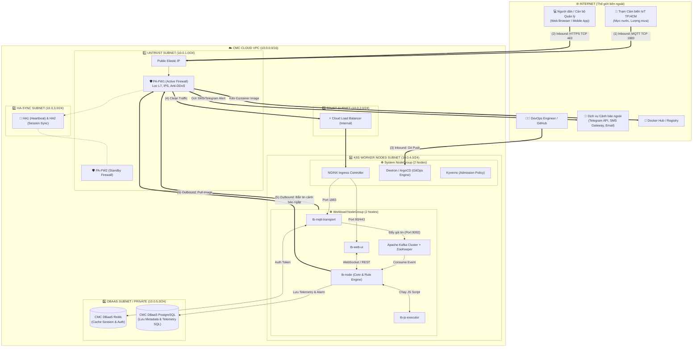

# KIẾN TRÚC LUỒNG HOẠT ĐỘNG TOÀN DIỆN HỆ THỐNG
## HỆ THỐNG CẢNH BÁO NGẬP VÀ THỜI TIẾT TP.HCM (THINGSBOARD TRÊN CMC CLOUD KUBERNETES)

---

## 1. Sơ đồ Tổng thể Kiến trúc 2 Chiều (Inbound & Outbound Topology)



---

## 2. Chi tiết Luồng INBOUND (Traffic từ ngoài Internet đi vào)

### 📥 Luồng A: Thu nhận dữ liệu Cảm biến IoT (Sensor Data Ingestion)
1. **Phát tín hiệu:** Trạm cảm biến đo ngập (hoặc bộ giả lập trong thư mục `simulator/`) gửi gói tin JSON qua giao thức **MQTT (Port 1883)**.
2. **Kiểm duyệt tại Tường lửa Biên (Palo Alto HA):**
   - Gói tin đến Public Elastic IP $\rightarrow$ vào `PA-FW1` (Active).
   - Firewall thực hiện: Chống tấn công DDoS/Flood, kiểm tra Application-ID (chỉ chấp nhận MQTT payload hợp lệ).
3. **Phân phối tải (Load Balancing & Ingress):**
   - Firewall chuyển tiếp traffic đã được lọc sạch sang **Internal Load Balancer** tại Subnet Trust $\rightarrow$ đưa vào **NGINX Ingress Controller** (chạy trên `System NodeGroup`).
   - Ingress định tuyến Port `1883` đến Pod `tb-mqtt-transport` (chạy trên `Workload NodeGroup`).
4. **Xác thực siêu tốc qua Cache:**
   - `tb-mqtt-transport` bóc tách `Device Token`, gửi truy vấn sang **CMC DBaaS Redis** (độ trễ < 1ms) để xác thực thiết bị hợp lệ.
5. **Xếp hàng an toàn vào Kafka:**
   - `tb-mqtt-transport` đẩy dữ liệu vào Topic của **Apache Kafka (Port 9092)** đóng vai trò hàng đệm chống nghẽn và mất gói tin khi mưa bão có tải tăng đột biến.

---

### 📥 Luồng B: Người dùng xem Dashboard & Giám sát (Web UI & WebSocket)
1. Cán bộ quản lý hoặc người dân truy cập qua giao thức **HTTPS (Port 443/80)**.
2. Gói tin đi qua Firewall $\rightarrow$ Load Balancer $\rightarrow$ Ingress $\rightarrow$ nạp giao diện từ Pod `tb-web-ui`.
3. `tb-web-ui` thiết lập kết nối **WebSocket** liên tục với `tb-node` để cập nhật trực tiếp biến động mực nước và hiển thị cảnh báo ngập đỏ/vàng theo thời gian thực mà không cần tải lại trang.

---

### 📥 Luồng C: Tự động hóa Triển khai (GitOps Inbound)
1. Kỹ sư DevOps đẩy thay đổi cấu hình mã nguồn lên kho lưu trữ GitHub.
2. **Devtron / ArgoCD** (chạy trên `System NodeGroup`) tự động phát hiện commit mới.
3. Devtron nạp cấu hình `helm/thingsboard/values.yaml`, kích hoạt **Kyverno Admission Controller** để thẩm định chính sách an toàn, rồi rolling-update các Pods trên `Workload NodeGroup`.

---

## 3. Chi tiết Luồng NỘI BỘ (East-West Intra-Cluster Traffic)

Quá trình xử lý logic nghiệp vụ diễn ra hoàn toàn trong mạng nội bộ (Private Subnets):

1. **Tiêu thụ sự kiện (Consume Event):** Pod `tb-node` rút các gói tin cảm biến từ hàng đợi **Kafka**.
2. **Xử lý JavaScript tùy biến:** Khi Rule Chain cần tính toán nâng cao (ví dụ: công thức dự báo tốc độ nước dâng), `tb-node` gọi sang `tb-js-executor` để chạy mã JS độc lập, tránh gây nghẽn luồng xử lý chính.
3. **Đánh giá ngưỡng ngập (Rule Engine):**
   - `water_level_cm < 35cm`: Trạng thái Bình thường (`normal`).
   - `35cm <= water_level_cm < 50cm`: Kích hoạt Cảnh báo ngập (`warning`).
   - `water_level_cm >= 50cm`: Kích hoạt Báo động nguy hiểm (`critical`).
4. **Lưu trữ dữ liệu:** `tb-node` ghi toàn bộ bản ghi quan trắc dạng chuỗi thời gian (SQL) và sự kiện Alarm vào **CMC DBaaS PostgreSQL (Port 5432)**.

---

## 4. Chi tiết Luồng OUTBOUND (Traffic từ hệ thống đi ra Internet)

Luồng Outbound đảm bảo hệ thống có thể chủ động **phát cảnh báo khẩn cấp** và **tải tài nguyên cần thiết** an toàn:

### 📤 Luồng D: Phát cảnh báo Ngập lụt Khẩn cấp (Alert Notification)
```
[tb-node phát hiện Ngập nguy hiểm]
          │
          ▼ (1) Gửi Webhook / REST API Request
[Route Table Subnet K8s] ───(Next-Hop)───> [Chân Trust Firewall (10.0.2.x)]
                                                     │
                                                     ▼ (2) Quét SSL, DLP, URL Filtering
                                            [Chân Untrust Firewall]
                                                     │
                                                     ▼ (3) Ra Internet
                                            [Telegram Bot / SMS Gateway / Email]
```

1. **Kích hoạt:** Khi mực nước vượt ngưỡng nguy hiểm $\rightarrow$ Rule Engine của `tb-node` tự động kích hoạt Action gửi thông báo.
2. **Định tuyến qua Firewall:** Gói tin Outbound từ Pod `tb-node` (trong `Subnet 10.0.4.0/24`) đi theo **Route Table riêng** có `Default Route (0.0.0.0/0)` trỏ Next-Hop vào **chân Trust của Palo Alto Firewall**.
3. **Kiểm duyệt an ninh:** Firewall kiểm tra gói tin:
   - Quét mã độc và chống rò rỉ dữ liệu (DLP).
   - Kiểm tra địa chỉ đích (URL Filtering): Chỉ cho phép gửi đến các endpoint hợp lệ như `api.telegram.org` hoặc SMS Gateway của nhà mạng.
4. **Gửi tin nhắn:** Gói tin ra ngoài Internet tới điện thoại của Cán bộ cứu hộ và người dân trong khu vực ngập.

---

### 📤 Luồng E: Kéo Container Image & Cập nhật Hệ thống (System Egress)
- Khi cụm K8s khởi tạo hoặc scale Pods, các Worker Nodes gửi request tải Image từ `docker.io`, `quay.io`.
- Toàn bộ lưu lượng Egress này cũng bắt buộc đi qua Firewall để ngăn chặn các container độc hại tự ý kết nối ra ngoài máy chủ hacker (C2 Server).

---

## 5. Ma trận Quy tắc Tường lửa & Định tuyến (Summary Matrix)

| Hướng | Nguồn (Source) | Đích (Destination) | Cổng / Giao thức | Mục đích |
| :--- | :--- | :--- | :--- | :--- |
| **INBOUND** | Internet (`0.0.0.0/0`) | Untrust Firewall IP | `TCP 1883` | Cảm biến đẩy dữ liệu MQTT |
| **INBOUND** | Internet (`0.0.0.0/0`) | Untrust Firewall IP | `TCP 80, 443` | Người dùng xem Web UI |
| **INBOUND** | Trust Subnet | K8s Ingress Controller | `TCP 8080, 8081` | LB chuyển tiếp traffic sạch vào K8s |
| **EAST-WEST**| `tb-mqtt-transport` | CMC DBaaS Redis | `TCP 6379` | Xác thực Token thiết bị |
| **EAST-WEST**| `tb-mqtt-transport` | Apache Kafka | `TCP 9092` | Đưa bản tin vào Queue |
| **EAST-WEST**| `tb-node` | CMC DBaaS PostgreSQL | `TCP 5432` | Đọc/Ghi dữ liệu & Alarm |
| **OUTBOUND** | Pod `tb-node` | Internet (Telegram / SMS) | `TCP 443` | Bắn tin cảnh báo ngập ra ngoài |
| **OUTBOUND** | K8s Worker Nodes | Internet (Docker Registries)| `TCP 443` | Kéo container images có kiểm soát |
